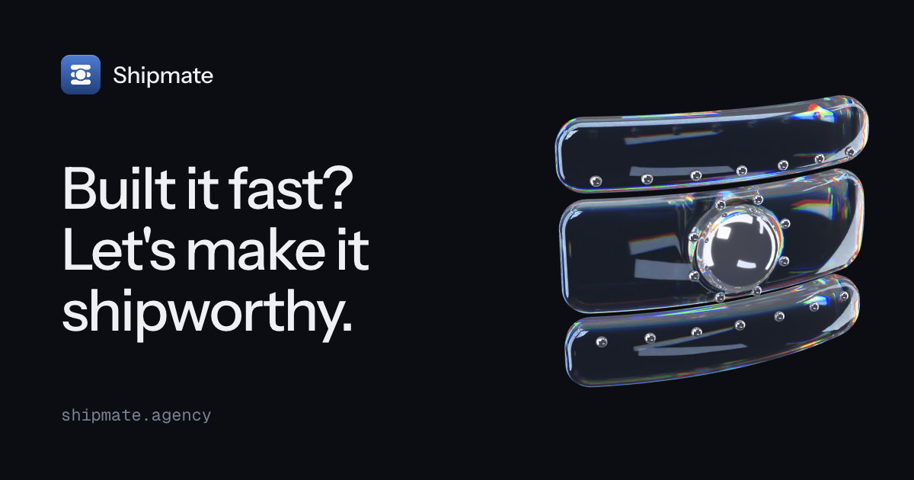

  

# Awesome Vibe-Code & AI Web App Security 

A curated directory of open-source security scanners, IDE guardrails, SQL audits, compliance templates, and hardening guides for web apps built fast with **Cursor, Lovable, Bolt, v0, Replit, Next.js, Supabase, Postgres, Stripe, and LLM APIs**.

Maintained by **[Shipmate](https://shipmate.agency)** (`hello@shipmate.agency`), a security review agency. Entries ending in **(Shipmate)** are the maintainers' own tools and articles; they are listed after the third-party resources in each section. PRs adding genuinely useful, open security resources are welcome — see [CONTRIBUTING.md](./CONTRIBUTING.md).

## Contents
- [Pre-Launch Scanners & MCP Tools](#pre-launch-scanners--mcp-tools)
- [IDE Guardrails (Cursor, Claude Code, Copilot)](#ide-guardrails-cursor-claude-code-copilot)
- [Supabase & Postgres RLS Hardening](#supabase--postgres-rls-hardening)
- [Next.js, Vercel & React Security](#nextjs-vercel--react-security)
- [Stripe & Billing Webhook Security](#stripe--billing-webhook-security)
- [AI / LLM Endpoint & Prompt Security](#ai--llm-endpoint--prompt-security)
- [Enterprise Reviews, SOC 2 & Attestation Templates](#enterprise-reviews-soc-2--attestation-templates)
- [Secrets, Dependencies & Headers](#secrets-dependencies--headers)
- [Benchmarks & Public Security Standards](#benchmarks--public-security-standards)

---

## Pre-Launch Scanners & MCP Tools
- [Semgrep](https://github.com/semgrep/semgrep) — Fast static analysis with strong JS/TS/React/Python security rulesets.
- [Gitleaks](https://github.com/gitleaks/gitleaks) — Secret scanner for Git repos, pre-commit hooks, and CI pipelines.
- [TruffleHog](https://github.com/trufflesecurity/trufflehog) — Finds and verifies live leaked credentials across repos and history.
- [Trivy](https://github.com/aquasecurity/trivy) — Vulnerability, IaC, and secret scanner for containers, lockfiles, and repositories.
- [Nuclei](https://github.com/projectdiscovery/nuclei) — Template-based vulnerability scanner for authorized staging/production testing.
- [ZAP](https://github.com/zaproxy/zaproxy) — Open-source dynamic web application scanner (DAST), formerly OWASP ZAP.
- [ShipReady](https://github.com/Shipmate-agency/shipready) — Zero-dependency CLI & GitHub Action checking Supabase RLS, exposed secrets, Stripe webhooks, and security headers (Shipmate).
- [ShipReady MCP](https://github.com/Shipmate-agency/shipready-mcp) — Local stdio MCP server bringing pre-launch security checks into Cursor, Claude Code, and Windsurf (Shipmate).

## IDE Guardrails (Cursor, Claude Code, Copilot)
- [awesome-cursorrules](https://github.com/PatrickJS/awesome-cursorrules) — Community directory of `.cursorrules` files across frameworks.
- [OWASP Developer Guide](https://devguide.owasp.org/) — Secure development guidance and checklists; now home to the archived Secure Coding Practices Quick Reference.
- [ShipReady rules for Cursor & Claude Code](https://github.com/Shipmate-agency/shipready-mcp#included-ide-guardrails) — Drop-in `.cursorrules`, `rules/*.mdc` and `CLAUDE.md` instructions asking the assistant to keep RLS on, verify Stripe webhooks, check auth in Server Actions, and cap AI tokens (Shipmate).

## Supabase & Postgres RLS Hardening
- [Supabase Row Level Security Docs](https://supabase.com/docs/guides/database/postgres/row-level-security) — Official Postgres RLS guide and policy patterns.
- [Supabase Security Advisor](https://supabase.com/docs/guides/observability/advisors) — Built-in dashboard linter that flags issues such as `rls_disabled_in_public` and `security_definer_view`.
- [Supabase RLS Audit Pack](https://github.com/Shipmate-agency/supabase-rls-audit-pack) — Single read-only SQL query listing public tables missing RLS, `USING (true)` write policies, and `SECURITY DEFINER` views (Shipmate).
- [Two-Account Supabase RLS Isolation Test](https://shipmate.agency/articles/supabase-rls-two-account-test) — How to verify tenant boundaries using two separate logins instead of trusting static checks (Shipmate).
- [Fix `rls_disabled_in_public` & `security_definer_view`](https://shipmate.agency/articles/supabase-rls-disabled-in-public-fix) — Exact Postgres 15+ SQL fixes (Shipmate).
- [Supabase Anon Key vs Service Role Key](https://shipmate.agency/articles/supabase-anon-key-vs-service-role-key) — What belongs in the browser and what never should (Shipmate).

## Next.js, Vercel & React Security
- [Next.js Data Security Guide](https://nextjs.org/docs/app/guides/data-security) — Official Next.js guidance on Data Access Layers, Server Actions, and taint APIs.
- [Vercel Firewall & Rate Limiting](https://vercel.com/docs/vercel-firewall) — Edge WAF and per-IP/route rate limits for Next.js apps.
- [Cloudflare Turnstile](https://developers.cloudflare.com/turnstile/) — Free CAPTCHA alternative for bot protection on signup and login forms.
- [Next.js Server Actions Are Public Endpoints](https://shipmate.agency/articles/nextjs-server-actions-are-public-endpoints) — Why every `"use server"` function needs explicit session and ownership checks (Shipmate).

## Stripe & Billing Webhook Security
- [Stripe Webhook Signature Verification Docs](https://docs.stripe.com/webhooks#verify-events) — Official guide to verifying the `Stripe-Signature` header with `constructEvent`.
- [Verified Next.js App Router Stripe Webhook Handler](https://github.com/Shipmate-agency/stripe-webhook-audit-nextjs) — Copy-paste `route.ts` fixing `No signatures found matching the expected signature for payload` without disabling verification (Shipmate).
- [Stripe Secret Keys in `NEXT_PUBLIC_` Variables](https://shipmate.agency/articles/stripe-secret-key-in-client-javascript-next-public) — How client env prefixes leak server secrets into browser bundles (Shipmate).

## AI / LLM Endpoint & Prompt Security
- [OWASP Top 10 for LLM Applications](https://genai.owasp.org/llm-top-10/) — Prompt injection, sensitive info disclosure, unbounded consumption (Denial of Wallet), and excessive agency.
- [Upstash Ratelimit](https://github.com/upstash/ratelimit-js) — Serverless HTTP rate limiting for Next.js / Edge API routes.
- [MCP Security Best Practices](https://modelcontextprotocol.io/docs/tutorials/security/security_best_practices) — Official security considerations for Model Context Protocol servers and clients.
- [Stop a Runaway AI API Bill](https://shipmate.agency/articles/stop-runaway-ai-bill) — Auth, rate limits, `max_output_tokens`, and hard spend caps for OpenAI/Anthropic routes (Shipmate).

## Enterprise Reviews, SOC 2 & Attestation Templates
- [Google OAuth CASA Tier 2 Assessment Guide](https://www.appdefensealliance.org/standards/casa) — App Defense Alliance's security assessment for apps requesting restricted Google OAuth scopes.
- [CSA Cloud Controls Matrix & CAIQ](https://cloudsecurityalliance.org/research/cloud-controls-matrix) — Cloud control framework and its yes/no vendor questionnaire (CAIQ).
- [Pentest Attestation Letter Template](https://github.com/Shipmate-agency/pentest-attestation-letter-template) — Clean Markdown template showing what goes into a buyer-ready pentest letter ([live sample](https://shipmate.agency/sample-letter)) (Shipmate).
- [Startup Security Questionnaire Answers (SIG Lite / VSA)](https://github.com/Shipmate-agency/startup-security-questionnaire-answers) — Honest starter answers to 18 common enterprise vendor review questions (Shipmate).
- [Does SOC 2 Require a Pentest?](https://shipmate.agency/articles/does-soc-2-require-a-pentest) — What AICPA Trust Services Criteria actually ask for (Shipmate).
- [Google OAuth CASA Tier 2 Pre-Flight Checklist](https://shipmate.agency/articles/google-oauth-casa-tier-2-preflight) — Blockers to fix before paying a CASA lab (Shipmate).

## Secrets, Dependencies & Headers
- [MDN HTTP Observatory](https://developer.mozilla.org/en-US/observatory) — Free scanner that grades a site's HTTP security headers and cookie settings.
- [OSV-Scanner](https://github.com/google/osv-scanner) — Google's open-source dependency vulnerability scanner backed by OSV.dev.
- [Socket.dev](https://socket.dev/) — Supply-chain security analysis for npm and PyPI packages.
- [Shipmate Security Header Checker](https://shipmate.agency/tools/security-headers) — Browser-based check of 6 common security headers with suggested fixes (Shipmate).

## Benchmarks & Public Security Standards
- [OWASP ASVS](https://asvs.owasp.org/) — Application Security Verification Standard; the basis for Google's CASA assessments.
- [OWASP Cheat Sheet Series](https://cheatsheetseries.owasp.org/) — Concise, battle-tested reference sheets for auth, sessions, CSRF, CSP, and SQLi.
- [Vibe-Vuln-Bench](https://github.com/Shipmate-agency/vibe-vuln-bench) — Standardized SaaS prompt and 10-check security grader for comparing AI app builders (Shipmate).

---

Part of **[Shipmate Open Source](https://github.com/Shipmate-agency)** · [shipmate.agency](https://shipmate.agency)
